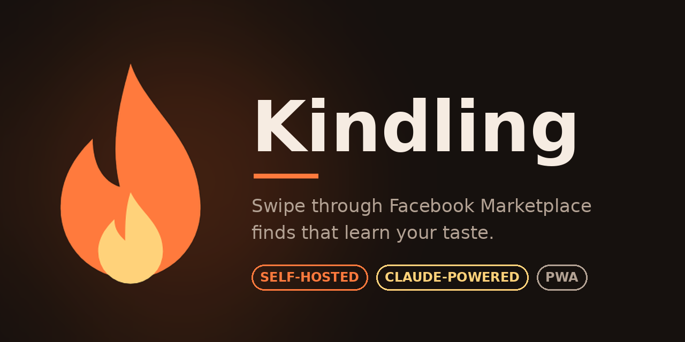

# Kindling



Tinder-style swiping for Facebook Marketplace. You describe what you're hunting for, Kindling pulls a batch of listings, Claude picks the most promising ones, and you swipe. Every swipe and every drag on the taste web teaches it, so each batch should land closer than the last.

Runs as a small self-hosted web app, used from your phone over a private network (e.g. Tailscale).

## Getting started

You need Python 3.10 or newer and a phone or browser. Nothing is spent until you add real API keys.

**1. Get the code and install**

```bash
git clone https://github.com/pb-matt-mc/kindling-app.git
cd kindling-app
python3 -m venv .venv
source .venv/bin/activate        # Windows: .venv\Scripts\activate
pip install -r requirements.txt
```

**2. Try it with fake listings (free)**

```bash
cp .env.example .env             # KINDLING_SOURCE defaults to mock when no keys are set
python -m app.cli admin-code     # prints a one-time sign-in code
uvicorn app.main:app --host 127.0.0.1 --port 8010
```

Open http://127.0.0.1:8010, enter the admin code, describe something you're hunting for, and start a batch. With no keys set, listings and Claude's picks are placeholders, so you can explore the whole app without spending anything.

**3. Get your API keys**

Real listings need two keys. Each service has its own sign-up, and their dashboards change, so follow their own docs if a screen looks different.

*ScrapeCreators (finds the listings)*
1. Create an account at [scrapecreators.com](https://scrapecreators.com).
2. Open the dashboard and copy your API key.
3. New accounts usually get some free credits, enough for roughly five batches. Kindling uses about 18 to 21 credits per 15-listing batch.

*Anthropic API (Claude judges the listings)*
1. Create an account at [console.anthropic.com](https://console.anthropic.com).
2. Add billing or buy credits. The API is billed separately from a Claude.ai chat subscription, so a subscription doesn't cover it.
3. Go to the API keys page, create a key, and copy it right away, because it's only shown once.
4. A 15-listing batch usually costs about $0.20 of Claude. Set a monthly spend limit in the console if you want a hard ceiling.

Then put both keys in `.env`:

```
KINDLING_SOURCE=scrapecreators
SCRAPECREATORS_API_KEY=your-scrapecreators-key
ANTHROPIC_API_KEY=your-anthropic-key
```

Restart the server after changing `.env`. While a key is missing the app shows an orange "Demo" badge (for example "Demo: fake listings, no Claude key"). When the badge is gone, you're on real data, and each batch shows the credits it used. Start with one small batch to check costs.

Keep the keys private: `.env` is gitignored, so don't commit it, and don't paste keys into chats, issues or screenshots. If one leaks, delete it in that service's dashboard and make a new one.

Without an Anthropic key Kindling falls back to simple keyword guessing, and without a ScrapeCreators key it uses fake listings. Both work for trying the app out.

**4. Use it from your phone (Tailscale)**

By default the server only listens on the machine it runs on. [Tailscale](https://tailscale.com) is a free way to make a private network between your devices, so your phone can reach the server from anywhere without exposing anything to the internet.

1. **Install Tailscale** on the machine running Kindling and on your phone (downloads at [tailscale.com/download](https://tailscale.com/download), or the phone's app store).
2. **Sign in to the same Tailscale account** on both devices. They'll appear in each other's device list.
3. **Find the server's Tailscale address.** On the server, run `tailscale ip -4`. It prints an address like `100.x.y.z`.
4. **Start Kindling on that address:**
   ```bash
   source .venv/bin/activate
   uvicorn app.main:app --host 100.x.y.z --port 8010
   ```
   Use the address from step 3. Binding to it means only devices on your Tailscale network can connect.
5. **Open it on your phone.** With Tailscale running on the phone, browse to `http://100.x.y.z:8010`.
6. **Sign in.** On the server run `python -m app.cli admin-code` and enter the code on the phone.
7. **Add it to your home screen** so it opens like an app. On Android Chrome use the menu, then "Add to Home screen" or "Install app". On iPhone Safari use Share, then "Add to Home Screen".

Other ways to connect:
- On a trusted home Wi-Fi you can use `--host 0.0.0.0`, then open `http://<the server's LAN IP>:8010`. Don't do this on public or shared networks.
- **Don't expose Kindling to the public internet**, and don't use Tailscale Funnel or port forwarding. Access is by invite code only, and the app wasn't built or reviewed for hostile traffic.

To let friends in, use Profile, then People, then "Invite someone". They'll need Tailscale access to your server too, for example by [sharing the device](https://tailscale.com/kb/1084/sharing) with them.

**5. Keep it running (optional, Linux)**

`deploy/kindling.service` is a systemd template. Replace `<USER>` and `<BIND_ADDRESS>` (your Tailscale address from step 4), and add `tailscaled.service` to the `After=` line so Tailscale is up first. Copy it to `/etc/systemd/system/` and run `sudo systemctl enable --now kindling`. Check it with `systemctl status kindling` and `journalctl -u kindling -f`.

**Your data**

Everything lives in the `data/` folder (SQLite database plus cached photos), created on first run. Back it up by copying that folder. Set `KINDLING_DATA_DIR` to store it elsewhere.

**Heads up**

Kindling gets listings through a third-party scraping service. Check that using it fits Facebook's terms and your local rules, and use it for your own personal shopping.

**Troubleshooting**

| Problem | What to try |
|---|---|
| Phone can't open the page | Check Tailscale is on for both devices, the URL uses the server's Tailscale address and port 8010, and the server is running |
| `Address already in use` | Another program has port 8010. Use `--port 8011` (and the same port in the URL) |
| `Cannot assign requested address` | The `--host` address isn't on this machine. Re-run `tailscale ip -4` and check Tailscale is up |
| Orange "Demo: fake listings" badge | `KINDLING_SOURCE` isn't `scrapecreators`, or the ScrapeCreators key is missing or wrong. Restart after editing `.env` |
| Orange "Demo: no Claude key" badge, or picks look like keyword guesses | The Anthropic key is missing or wrong. Restart after editing `.env`. If it's set, check the account has credits |
| "You've used this week's $3.00 of Claude" | That account hit its weekly Claude cap. It resets on Monday, or raise it with "Cap" on the People card |
| Sign-in code rejected | Codes are single-use and expire in 7 days. Make a new one with `python -m app.cli admin-code` or `invite` |
| Lost the admin code or a phone | Run `python -m app.cli admin-code` again on the server |

## How it flows

• Home: SWIPE, Your likes, Your profile. Fresh likes fly into the Likes card when you come back.
• Swipe: right likes, left passes, up (or tap the lower half) shows why it was picked: match score, checklist, Claude's take, seller details. Tap the left or right edge of the photo to flip photos, the middle to open it full screen. Undo is the curved arrow.
• Photos: tap any photo (card middle or info sheet) for full screen. Pinch or double-tap to zoom, drag to pan, swipe sideways between photos, swipe down or ✕ to close.
• Batch recap: opens when a batch is fully swiped. "Called right" chart, thumbnail grid (tap to flip a call), and the Rank web for this batch. Done sends your rankings to the learner and the next batch button appears.
• Your likes: the taste web for everything you've swiped. Center = love, edge = nope, dashed ring = meh. Drag in or out to re-rank, drop one onto another (gold ring) to make or join a category you name. Zoomed out shows trait clusters, middle shows photos and your categories, close shows names and prices.
• Your profile: the hunt (description, checklist, price, location, radius), taste summary, what drives your swipes, the is-it-learning chart, and every batch's searches with hit rates. "+ New hunt" starts a separate profile with its own swipe history.

## Reposts

Sellers often post the same item more than once, under different listing IDs. Each batch fingerprints every thumbnail and treats two listings as the same item when the main photo is near-identical and the price or title also matches, or when title, price and location are all identical. Only one copy makes it into the batch (the cheaper one if a repost dropped the price), and reposts of anything the hunt has already been shown are skipped in later batches too. The log notes how many were dropped.

## Crystals

• The web holds 50 swiped listings. You can start a batch any time you're under 50 (even one that takes you past it), but once you're at 50 or more, New Batch locks until you crystallize.
• Crystallize lives on the Likes page: a small ◆ button any time, a big mandatory one once the web is full.
• Flow: swipe right on liked listings you might still buy (keepers), review the confirm screen, tap any listing to keep it in the new web, then crystallize. No undo.
• Kept in the crystal: the raw evidence behind every trait (rank offsets, counts, likes), your categories as concepts, the search-term record, the taste summary, and the seen list.
• Let go: every listing that isn't a keeper or kept in the web, plus its photos and links. Batch history numbers are frozen first so the profile charts survive.
• Older crystals count half as much each time a new one forms, so taste can drift.
• The new web shows the last crystal's trait names as faint ◆ landmarks. Keepers live in the Keepers tab on the Likes page.

## Batch rules

In "Batch extras" on the New Batch screen, these prefixes are hard rules for the batch:
• `-used`: the word or phrase can't appear anywhere in the listing (title, description, condition, seller details). "pet hair" also catches "pet-hair".
• `!leather`: the item can't be leather; Claude judges the item itself, so faux or leather-look counts.
• `$750`: price under $750. `+$100`: price over $100. Listings with no price are left out when a price rule is set.
Anything without a prefix is a soft nudge. Rules are enforced on search results, again after the closer look, and the batch refills up to three times from the next best matches.
Extras carry over to the next batch on the same hunt, pre-filled as tiles. Tap ✕ on one or "Clear" to drop them. They never change the saved hunt.

## Export

The download button in any web view (Likes or a batch recap) offers "Copy for Google Sheets" (paste into A1) or a CSV download. Columns: name, link, price, top 5 qualities (the listing's traits, strongest sway first), your ranking 0-100, your call, Claude's expected approval.
"Download Excel, with photos" gives an .xlsx with each listing's first photo in a Photo column, a small copy stored inside the file, so it keeps working anywhere. Copy and CSV can't carry photos: they live only on your private server, where Google can't fetch them.
The Keepers tab has its own Export button with the same columns and the same options.

## Accounts

No passwords. Every person and device gets in with a one-time invite code (8 characters, expires in 7 days); the device then stays signed in for a year.

• First time after updating: on the server run `python -m app.cli admin-code` and enter that code on your phone. All the existing hunts, swipes and crystals belong to the admin account.
• Invite a friend: Profile → People → "Invite someone". Share the link or code. They pick a name and get their own empty hunt. Standard accounts see only their own hunts, likes and batches, never anyone else's, the logs, or the People list.
• Another of your own devices: Profile → People → "Sign in another of my devices".
• Claude budget: each standard account gets $3 of Claude per week by default (change it with "Cap"). Spend is priced from the token counts the API reports on every call. Weeks reset Monday at midnight, server time. A 15-listing batch is usually about $0.20. When the budget runs out, new batches lock until the reset; the web, likes and keepers stay usable. Admin has no cap.
• ScrapeCreators credits are shared from one key with no per-person cap; the People card shows each person's credits this week.
• "Turn off" signs a person out everywhere and blocks them. Only the admin's batches write notes to Obsidian.
• From the server: `python -m app.cli invite --cap 3` and `python -m app.cli users`.

## Profile page

Every card folds: tap its title. Which ones are folded is remembered on that phone.

The Spending card shows your own Claude dollars and ScrapeCreators credits for this week, the last 30 days and all time, two charts of the last 8 weeks (tap a bar to read it), a split by hunt and by Claude model, and the average Claude cost per batch. Credits are shown as plain counts, never converted to dollars. The admin also sees everyone's totals and the credits left on the ScrapeCreators key, checked at most every 10 minutes. Claude spend only exists from the accounts update on; older batches show credits but no Claude cost.

## How the learning works

• Each listing gets trait tags from Claude (color, style, material, shape, features) plus price, size and condition tags.
• Each swipe sets a rank (like 0.75, pass 0.25); dragging on the web refines it anywhere from 0 to 1.
• A trait's weight is how far its listings' ranks sit from your average, shrunk toward zero until it has been seen a few times.
• Predicted match = Claude's score blended with the trait model. The model's share grows with swipes, capped at 60% so Claude's eyes always count.
• Next batch: Claude writes new search terms from what worked, thumbnails get screened, the best go through a closer look, and 20% of the batch is "wildcard" picks so it doesn't tunnel-vision.
• After each batch Claude rewrites the short taste summary that feeds all of the above.

## Costs (ScrapeCreators)

• 1 credit per search request (about 24 listings) and 1 per listing detail.
• A 15-listing batch is about 18 to 21 credits. The free 100 credits covers roughly 5 batches.
• Credits used are shown on the profile page per batch.

## Settings

Everything lives in `.env` (see `.env.example`). `KINDLING_SOURCE=mock` runs the whole app with fake listings and no spend, handy for poking at it.

## Layout

• `app/main.py` API and static serving
• `app/pipeline.py` batch builder (queries, search, screen, pick, detail, score)
• `app/learn.py` trait weights, prediction blend, web graph
• `app/brain.py` Claude prompts plus the keyword fallback
• `app/sources.py` ScrapeCreators, Apify (dormant alternative) and the mock source
• `app/obsidian.py` optional batch notes into the vault
• `static/` the phone web app (vanilla JS, d3 vendored locally)
• `data/` SQLite database and cached listing photos (created on first run, not in git)
